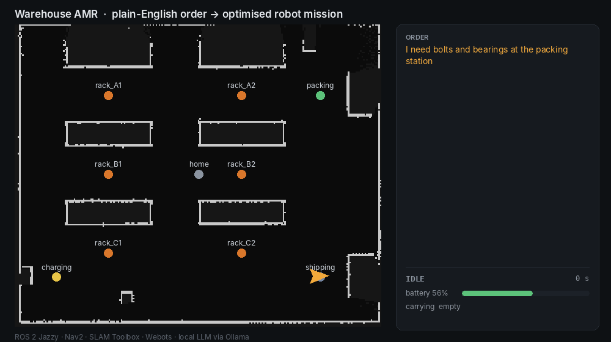

# Autonomous Warehouse AMR — ROS 2 Jazzy · Nav2 · on-device LLM agent

[](https://github.com/Rishabh-Kothari-tech/warehouse-amr-ros2/actions/workflows/ci.yml)

A differential-drive warehouse robot in a racked Webots warehouse: SLAM mapping, AMCL localization, Nav2
navigation, a mission layer with a route optimiser, and an **AI agent that turns plain-English orders into
validated robot missions**, running fully on a laptop GPU with a free 3B open model. Built for the IIT
Gandhinagar PG Diploma (AI-ML & Agentic AI Engineering), Forward Deployed Engineering track.



*A real recorded mission (sped up): the on-device model parses the order, the optimiser sequences the pick-ups on
Nav2 path lengths, and the robot drives it. The trail is the robot's actual path.*

## What it does

```
"I need bolts and bearings at the packing station"
   │  Qwen 2.5 3B (Ollama, on-device) → constrained JSON intent: deliver [bolts_m8, bearings_6204] → packing_station
   │  verifiers: every product, destination and charge command must be grounded in the request text
   │  route optimiser: exact pickup/drop sequencing on Nav2 path lengths, 2-item capacity, battery rule
   ▼
warehouse_manager → Nav2 NavigateToPose → diff_drive_controller → Webots robot
```

| Layer | Highlights |
|---|---|
| Simulation | 12 × 10 m racked warehouse (6 rack bays, 1.8 m aisles, packing, shipping, charging dock), generated from one layout script; 2D LiDAR, ros2_control diff drive with calibrated odometry |
| Mapping & localization | SLAM Toolbox map (drift 3 cm over a 45 m lap), AMCL on the saved map |
| Navigation | Nav2 at 0.45 m/s with a time-to-collision collision monitor; unmapped obstacles planned around |
| Mission layer | `warehouse_manager`: stations + inventory, validated multi-step missions, battery and cargo model, retry |
| Route optimiser | exact branch-and-bound pickup-and-delivery (capacity, precedence) on Nav2 path lengths: 22–51% less driving than one-at-a-time |
| AI agent | hybrid on-device agent (constrained intent parsing + deterministic planning + grounding verifiers); Claude tool-use loop and rule-based fallback as alternatives |
| Operations | live web dashboard (map, robot, plan, activity, KPIs, command box), JSONL decision log, CI |

## Agent evaluation

32 natural-language requests scored automatically against an in-memory warehouse (`ros2 run amr_agent evaluate`).
A failure is **unsafe** if the robot ran a mission the person did not ask for.

| Agent | dev (12) | held-out v1 (10) | **held-out v2 (10, fresh)** | unsafe actions |
|---|---|---|---|---|
| Keyword rules (baseline) | 5 | 5 | 3 | 2 |
| Qwen 2.5 3B, free-form tool-use loop | 3 | 2 | 5 | 4 |
| **Qwen 2.5 3B, hybrid agent + verifiers** | **11** | **9** | **10** | **0** |

- *dev* was used while writing prompts; *held-out v1* has been seen failing, so it is no longer blind; *held-out v2*
  was committed **before** the last fix ([`6db88a1`](../../commit/6db88a1)) and never used for tuning.
- Three live failures (a hallucinated delivery, a wrong destination, a regression after adding a station) each
  became a verifier and a regression test. Details: [`docs/agentic_layer.md`](docs/agentic_layer.md).
- Claude was not benchmarked: the API account had no credits. The backend is implemented and selectable.

## Live operations dashboard

`ros2 launch amr_dashboard ops.launch.py` → **http://localhost:8765**: live map with robot, Nav2 plan and trail;
battery, cargo and mission; an activity feed showing the model's intent, verifier corrections and optimiser
results; KPIs from the decision log; and a command box for plain-English orders.

## Quick start (Ubuntu 24.04 / WSL2, ROS 2 Jazzy, Webots R2025a)

```bash
bash scripts/setup.sh --agent        # ROS deps, Ollama + qwen2.5:3b, build
source install/setup.bash

ros2 launch amr_simulation warehouse_simulation.launch.py   # A: Webots warehouse + robot
ros2 launch amr_simulation amr_navigation.launch.py         # B: AMCL + Nav2 on maps/warehouse_map_v4
ros2 launch amr_tasks warehouse_tasks.launch.py             # C: mission layer
ros2 launch amr_dashboard ops.launch.py                     # D: agent + dashboard on :8765
# or talk to it in a terminal:  ros2 run amr_agent chat
```

Mapping mode instead of B: `ros2 launch amr_simulation amr_slam.launch.py` and `python3 scripts/mapping_drive.py`
(never run SLAM and AMCL together: both publish `map → odom`). On WSL, close the Windows Webots process between
runs (`stop_sim.sh`), or the next launch connects to the stale instance.

## Packages

| Package | Contents |
|---|---|
| `amr_simulation` | Webots worlds, robot URDF + ros2_control, controller / SLAM / Nav2 configs, launch files |
| `amr_interfaces` | `Station`, `MissionStep`, `Order` msgs; `ListStations`, `GetRobotStatus`, `PlanOrders` srvs; `ExecuteMission` action |
| `amr_tasks` | `warehouse_manager` mission executor and the order scheduler |
| `amr_agent` | hybrid / Claude / local tool-loop / rule agents, `chat` CLI, `agent_node`, `evaluate` benchmark |
| `amr_dashboard` | live web dashboard (stdlib HTTP server, no web framework) |
| `amr_description`, `amr_bringup` | standalone URDF + RViz view; helper nodes |

`scripts/`: `generate_warehouse_world.py` (world + stations from one layout), `mapping_drive.py`,
`record_demo.py` + `render_demo_gif.py` (this README's GIF), `setup.sh`.

## Engineering notes

The debugging history is part of the project: [`PROJECT_LOG_2026-11-27.md`](PROJECT_LOG_2026-11-27.md) (controllers
not activating on Jazzy, wheel-separation calibration, stale Webots instances) and
[`docs/agentic_layer.md`](docs/agentic_layer.md) (agent design, live failures, speed tuning, racked-warehouse
LiDAR blind spot).

## Roadmap

Multi-robot fleet allocation (needs more WSL memory) · voice front-end on `/agent/command` · Claude vs on-device
comparison once API credits are available · learned travel-time and battery models from the decision log
