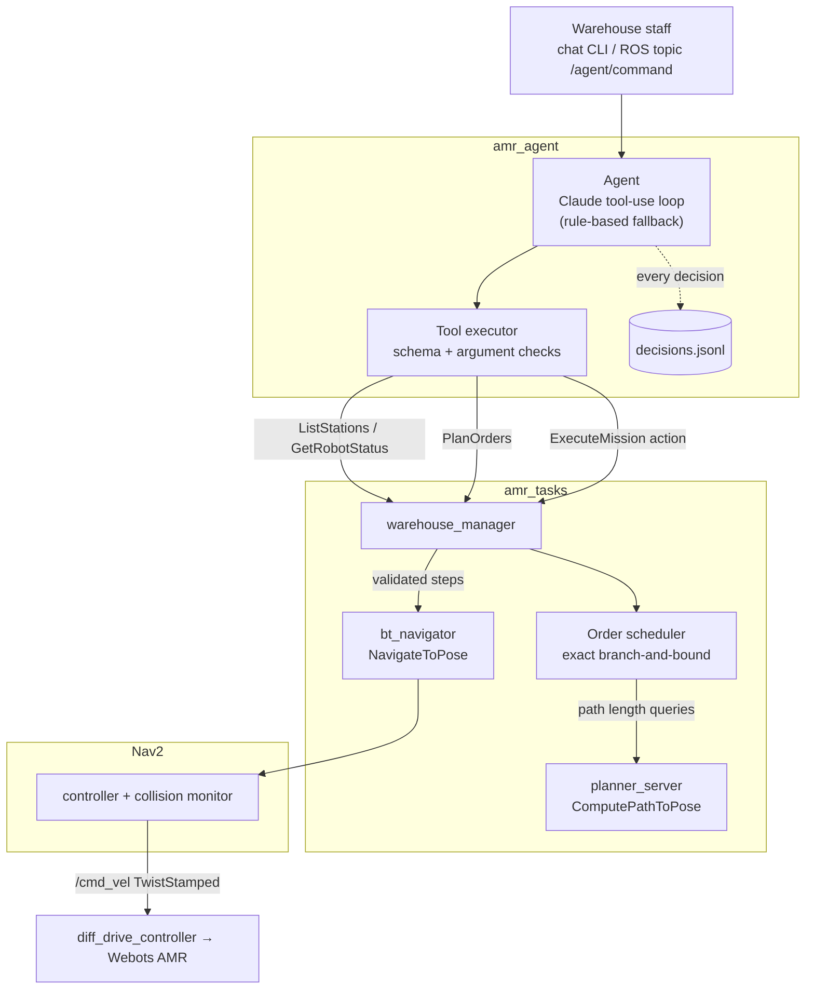

# Agentic layer: from plain English to robot missions

This layer turns a request like *"we're out of wiring harnesses on the line, bring one to packing"* into a
validated, distance-optimised mission that the AMR executes on Nav2.

## Architecture



## Packages

| Package | Role |
|---|---|
| `amr_interfaces` | `Station`, `MissionStep`, `Order` msgs; `ListStations`, `GetRobotStatus`, `PlanOrders` srvs; `ExecuteMission` action |
| `amr_tasks` | `warehouse_manager` node: station + inventory registry (`config/stations.yaml`), mission executor on Nav2, simulated battery and cargo, order scheduler, RViz station markers |
| `amr_agent` | Claude tool-calling agent, rule-based fallback, `chat` CLI, `agent_node` (ROS topics), `evaluate` benchmark |

## The agent's tools

| Tool | What it does |
|---|---|
| `get_robot_status` | pose, battery, state, cargo, capacity |
| `list_stations` | stations with coordinates and stocked SKUs |
| `find_item` | fuzzy inventory search: "BMS" → `bms_board` @ `shelf_4` |
| `plan_orders` | optimal pickup/drop-off sequence on real Nav2 path lengths |
| `execute_mission` | run steps (goto / pick / drop / charge) and wait for the result |
| `cancel_mission` | stop the running mission |

The LLM never touches Nav2 or `/cmd_vel`. Safety is layered:
1. **Tool schemas** constrain what can be expressed (closed action set).
2. **Tool executor** rejects unknown stations, missing items, malformed steps before anything is sent.
3. **warehouse_manager** validates the whole mission again before moving: SKU stocked at that shelf, capacity,
   drop only what is carried, charge only at the charger, refuse non-charging trips on a critical battery.
4. **Nav2 collision monitor** stops the robot if anything enters the stop zone, whatever was commanded.

## Order scheduling

Pickup-and-delivery with capacity is a small vehicle-routing problem. `amr_tasks/scheduler.py` solves it
exactly for up to 7 orders (depth-first branch-and-bound with state-dominance pruning; verified against brute
force in the unit tests) and falls back to greedy + local search beyond that. Distances are lengths of the
Nav2 global plan between stations, so the optimiser accounts for driving around shelves.

Measured in simulation (capacity 2):

| Request | Optimised | One-at-a-time | Saving |
|---|---|---|---|
| bolts + BMS board → packing | 8.5 m | 15.1 m | 44% |
| bolts + BMS board + bearings → packing, end at charger | 19.7 m | 26.8 m | 26% |

The delivery of bolts + BMS board drove 7.9 m in 97 s end to end.

## Evaluation

`ros2 run amr_agent evaluate` runs 10 natural-language requests against an in-memory warehouse (instant,
deterministic, no robot time) and scores which items moved where, whether the robot charged first when the
battery required it, and whether it correctly did nothing.

| Agent | Score |
|---|---|
| Rule-based keyword parser (baseline) | 5 / 10 |
| Claude (tool use) | see `PROJECT_LOG` / run `evaluate` with an API key |

The baseline fails on paraphrases ("top it up", "I need a bearing…", "send the robot to shelf three"), which is
the gap the LLM agent exists to close.

## Running it

```bash
# API key for the LLM agent (optional; without it the rule-based agent is used)
mkdir -p ~/.config/amr_agent
printf 'export ANTHROPIC_API_KEY=%s\n' 'sk-ant-...' > ~/.config/amr_agent/env && chmod 600 ~/.config/amr_agent/env
pip install --user --break-system-packages anthropic

ros2 launch amr_simulation warehouse_simulation.launch.py   # terminal A
ros2 launch amr_simulation amr_navigation.launch.py         # terminal B
ros2 launch amr_tasks warehouse_tasks.launch.py             # terminal C
ros2 run amr_agent chat                                     # terminal D: talk to the robot

# or over ROS topics
ros2 launch amr_agent agent.launch.py
ros2 topic pub --once /agent/command std_msgs/msg/String "{data: 'bring me bolts and a BMS board'}"
ros2 topic echo /agent/response
```

Model: `claude-sonnet-5-5` by default; override with `AMR_AGENT_MODEL` or `--model`. Every request, tool call and
reply is appended to `~/.ros/amr_agent/decisions.jsonl`.

## Simulation assumptions
Pick and drop are 3 s dwells with a cargo manifest (no manipulator). The battery drains 1.5 %/m driven and charges
at 8 %/s at the dock. Station poses live in `amr_tasks/config/stations.yaml` in the frame of `maps/warehouse_map_v3`.
