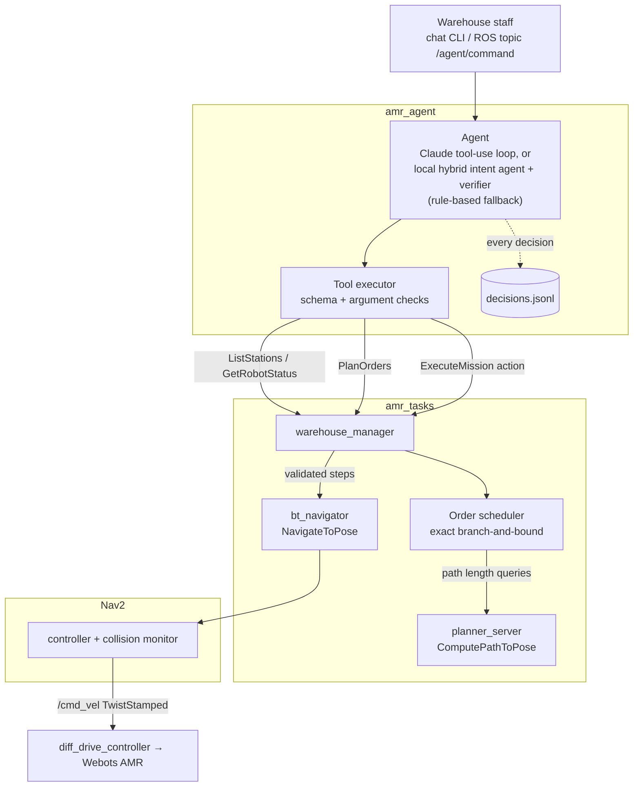

# Agentic layer: from plain English to robot missions

This layer turns a request like *"we're out of wiring harnesses on the line, bring one to packing"* into a
validated, distance-optimised mission that the AMR executes on Nav2. It runs fully on-device with a free 3B
open model (Qwen 2.5 3B via Ollama on a 4 GB GTX 1650), or with Claude through the API.

## Architecture



## Packages

| Package | Role |
|---|---|
| `amr_interfaces` | `Station`, `MissionStep`, `Order` msgs; `ListStations`, `GetRobotStatus`, `PlanOrders` srvs; `ExecuteMission` action |
| `amr_tasks` | `warehouse_manager` node: station + inventory registry (`config/stations.yaml`), mission executor on Nav2, simulated battery and cargo, order scheduler, RViz station markers |
| `amr_agent` | Agents (Claude tool loop, local hybrid intent agent, local tool loop, rule-based), `chat` CLI, `agent_node` (ROS topics), `evaluate` benchmark |

## Agent backends

| Backend (`--backend`) | How it works | Needs |
|---|---|---|
| `claude` | Claude runs the multi-step tool loop itself | `ANTHROPIC_API_KEY` with API credits |
| `local` | **Hybrid.** One call to a local model returns a JSON *intent* (deliver / goto / charge / status / ...), decoded under a JSON schema generated from the live inventory, so it cannot name an unknown SKU or station. A **verifier** then checks every product is actually mentioned in the request; if not, the model gets one retry with the error, and if it still disagrees the robot does not move and the agent asks a question. Planning and execution are deterministic code. | Ollama + `qwen2.5:3b` (1.9 GB) |
| `ollama` | Local model runs the same free-form tool loop as Claude | Ollama |
| `rule` | Keyword parser | nothing |

`auto` (default) picks Claude if a test call succeeds, otherwise `local` if Ollama is running, otherwise `rule`.

## The agent's tools

| Tool | What it does |
|---|---|
| `get_robot_status` | pose, battery, state, cargo, capacity |
| `list_stations` | stations with coordinates and stocked SKUs |
| `find_item` | fuzzy inventory search: "BMS" → `bms_board` @ `shelf_4` |
| `plan_orders` | optimal pickup/drop-off sequence on real Nav2 path lengths |
| `execute_mission` | run steps (goto / pick / drop / charge) and wait for the result |
| `cancel_mission` | stop the running mission |

The LLM never touches Nav2 or `/cmd_vel`. Safety is layered:
1. **Tool schemas** constrain what can be expressed (closed action set).
2. **Tool executor** rejects unknown stations, missing items, malformed steps before anything is sent.
3. **warehouse_manager** validates the whole mission again before moving: SKU stocked at that shelf, capacity,
   drop only what is carried, charge only at the charger, refuse non-charging trips on a critical battery.
4. **Nav2 collision monitor** stops the robot if anything enters the stop zone, whatever was commanded.

## Order scheduling

Pickup-and-delivery with capacity is a small vehicle-routing problem. `amr_tasks/scheduler.py` solves it
exactly for up to 7 orders (depth-first branch-and-bound with state-dominance pruning; verified against brute
force in the unit tests) and falls back to greedy + local search beyond that. Distances are lengths of the
Nav2 global plan between stations, so the optimiser accounts for driving around shelves.

Measured in simulation (capacity 2):

| Request | Optimised | One-at-a-time | Saving |
|---|---|---|---|
| bolts + BMS board → packing | 8.5 m | 15.1 m | 44% |
| bolts + BMS board + bearings → packing, end at charger | 19.7 m | 26.8 m | 26% |

The delivery of bolts + BMS board drove 7.9 m in 97 s end to end.

## Evaluation

`ros2 run amr_agent evaluate` runs natural-language requests against an in-memory warehouse (instant, deterministic,
no robot time) and scores which items moved where, whether the robot charged first when the battery required it,
and whether it correctly did nothing. Every failure is also classified as **unsafe** if a mission ran that the
person did not ask for, or safe if the robot did not move.

Two request sets:
- **dev** (11): used while writing the prompts. Includes a regression case from a live failure (below).
- **held-out** (10): written after the prompts were final and never used for tuning. New phrasings, other SKUs,
  an adversarial "laptop charger" (not stocked; "charger" is a trap) and a low-battery delivery.

Results on a laptop (GTX 1650 4 GB, WSL2), 27 Nov 2026:

| Agent | dev | **held-out** | unsafe actions |
|---|---|---|---|
| Keyword rules (baseline) | 5 / 11 | 5 / 10 | 0 |
| Qwen 2.5 3B, free-form tool loop | 3 / 11 | 2 / 10 | 2 |
| **Qwen 2.5 3B, hybrid intent agent + verifier** | **10 / 11** | **9 / 10** | **0** |
| Claude (`claude-sonnet-5-5`), tool loop | not run: API account had no credits | | |

What the numbers show:
- A 3B model cannot run a free-form tool loop reliably: it describes plans without calling `execute_mission`,
  claims deliveries that never happened, and sometimes executes the wrong mission.
- Narrowing the model's job to constrained intent parsing makes the same model beat the keyword baseline by a wide
  margin, with one model call per request instead of 4-8.
- Remaining misses ("head home", "now send the robot over to the charger and top it up") end in a safe refusal.

### A live failure and the verifier

In the first live run, *"now send the robot over to the charger and top it up"* was parsed by the 3B model as
*deliver motor_controller and bms_board to charging_dock*, and the robot executed it. Every safety check passed,
because the mission was feasible; nothing checked that it was what the person asked for. The fix is the grounding
verifier described above (the model proposes, code verifies). The request is now in the dev set as a regression
case: it is no longer executed wrongly, though the 3B model still does not understand it, so it ends in a safe
refusal.

### Live missions in simulation

| Request | Agent | Result |
|---|---|---|
| "bring me bolts and a BMS board" | rule | optimised 8.5 m vs 15.1 m one-at-a-time; delivered, 7.9 m in 97 s |
| "the line is out of wiring harnesses and also needs a BMS board, bring both to packing" | local hybrid | optimised 9.8 m vs 20.0 m (51% shorter); delivered, 9.2 m in 93 s |
| "go home" over `/agent/command` | rule | 3.2 m in 38 s |
| "bring me bolts and a BMS board" (after speed tuning, below) | local hybrid | **8.1 m in 45 s; 47 s end to end** |

### Speed tuning

The first version drove at Nav2's conservative 0.2 m/s and the local model was unloaded by Ollama after 5 idle
minutes (≈45 s to reload under WSL). Changes, all measured on the same request ("bring me bolts and a BMS board"):

| | Before | After |
|---|---|---|
| Pure-pursuit cruise speed / smoother limit / spin speed | 0.2 m/s / 0.25 m/s / 0.5 rad/s | 0.45 m/s / 0.5 m/s / 1.0 rad/s |
| Pick / drop dwell | 3 s | 1.5 s |
| Model residency | unloaded after 5 min idle | `keep_alive` 60 min + background warm-up at start |
| Agent time before the robot moves | ≈51 s cold, ≈5 s warm | ≈2–5 s |
| Mission time | 97 s | **45 s** |

Faster driving needs earlier braking (0.45 m/s at 0.4 m/s² takes ≈0.25 m). A fixed 0.8 m slowdown circle was tried
first and made things worse: pick poses sit ≈0.45 m from the shelves, so the robot crawled at ≈2 cm/s near every
station and tripped Nav2's progress checker (122 s mission, two aborts). It was replaced by the collision monitor's
time-to-collision `approach` mode (footprint projected along the current velocity, 1.2 s horizon): full speed in open
aisles, normal docking at shelves. Re-tested with an unmapped box in the path at the new speed: 0 aborts, closest
approach ≈0.38 m from the front bumper.

## Running it

```bash
# Free local model (recommended on a laptop)
sudo apt-get install -y zstd && curl -fsSL https://ollama.com/install.sh | sh
ollama pull qwen2.5:3b

# Optional: Claude (needs API credits)
mkdir -p ~/.config/amr_agent
printf 'export ANTHROPIC_API_KEY=%s\n' 'sk-ant-...' > ~/.config/amr_agent/env && chmod 600 ~/.config/amr_agent/env
pip install --user --break-system-packages anthropic

ros2 launch amr_simulation warehouse_simulation.launch.py   # terminal A
ros2 launch amr_simulation amr_navigation.launch.py         # terminal B
ros2 launch amr_tasks warehouse_tasks.launch.py             # terminal C
ros2 run amr_agent chat                                     # terminal D: talk to the robot (--backend local|claude|rule)

# or over ROS topics
ros2 launch amr_agent agent.launch.py
ros2 topic pub --once /agent/command std_msgs/msg/String "{data: 'bring me bolts and a BMS board'}"
ros2 topic echo /agent/response
```

Models: `claude-sonnet-5-5` (`AMR_AGENT_MODEL`) and `qwen2.5:3b` (`AMR_OLLAMA_MODEL`); or pass `--model`. Every request, tool call and
reply is appended to `~/.ros/amr_agent/decisions.jsonl`.

## Simulation assumptions
Pick and drop are 3 s dwells with a cargo manifest (no manipulator). The battery drains 1.5 %/m driven and charges
at 8 %/s at the dock. Station poses live in `amr_tasks/config/stations.yaml` in the frame of `maps/warehouse_map_v3`.
