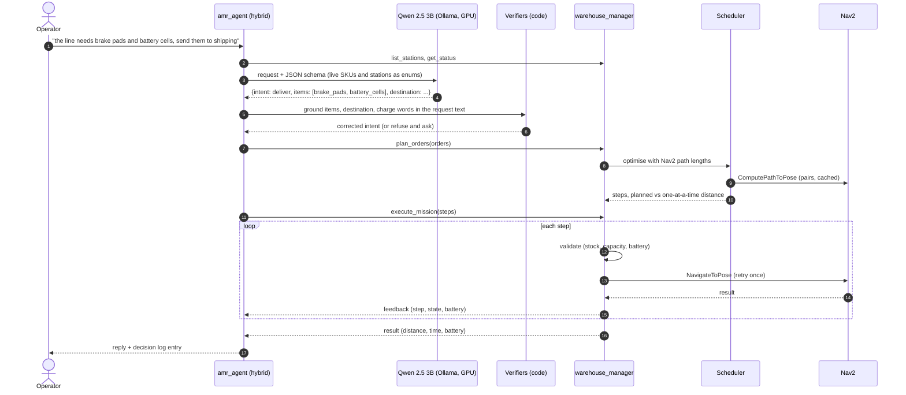

# System architecture

Warehouse AMR v1.0. Layered so that every layer can be tested and replaced on its own, and so that the AI layer
can never bypass the layers below it: the language model produces *intent*, never motion.

## 1. System context

```mermaid
flowchart LR
    OP(["Warehouse operator<br/>plain-English orders"]) --> DASH["Ops dashboard<br/>:8765"]
    OP --> CLI["chat CLI"]
    WMS(["WMS / other systems<br/>(future)"]) -.-> TOPIC["/agent/command"]
    DASH --> TOPIC
    CLI --> AG
    TOPIC --> AG["AI agent<br/>amr_agent"]
    AG --> WM["Mission layer<br/>amr_tasks"]
    WM --> NAV["Nav2"]
    NAV --> CTRL["ros2_control<br/>diff drive"]
    CTRL --> SIM["Webots warehouse<br/>robot + LiDAR"]
    SIM --> LOC["SLAM Toolbox / AMCL"]
    LOC --> NAV
    WM --> DASH
    AG -. decisions.jsonl .-> DASH
```

## 2. Layers

| # | Layer | Package / component | Responsibility | Never does |
|---|---|---|---|---|
| L7 | Operations | `amr_dashboard`, decision log | Live map, status, activity feed, KPIs, command entry | Command the robot directly |
| L6 | Agentic interface | `amr_agent` | Turn language into a validated intent; choose and call tools | Publish velocities, call Nav2, invent stations/SKUs |
| L5 | Planning & optimisation | `amr_tasks.scheduler` | Exact pickup/delivery sequencing on Nav2 path lengths | Move the robot |
| L4 | Mission execution | `amr_tasks.warehouse_manager` | Validate and run missions, battery and cargo model, retries | Accept unknown stations, over-capacity or unstocked picks |
| L3 | Navigation | Nav2 (planner, RPP controller, BT navigator, collision monitor) | Global/local planning, obstacle avoidance, time-to-collision braking | Know about orders or items |
| L2 | Localization & mapping | SLAM Toolbox (mapping mode) or map_server + AMCL (operation mode) | `map → odom` | Run both modes at once |
| L1 | Control | ros2_control `diff_drive_controller` | Wheel commands, calibrated odometry, accel limits | — |
| L0 | Plant | Webots world (generated), robot, LiDAR | Physics, sensing | — |

## 3. Request flow



## 4. ROS 2 interface catalogue

| Name | Kind | Type | Producer → consumer |
|---|---|---|---|
| `/agent/command` | topic | `std_msgs/String` | dashboard, other systems → `agent_node` |
| `/agent/response` | topic | `std_msgs/String` (JSON) | `agent_node` → dashboard |
| `/agent/events` | topic | `std_msgs/String` (JSON) | `agent_node` → dashboard (intent, verifier, tool calls, feedback) |
| `/warehouse/execute_mission` | action | `amr_interfaces/ExecuteMission` | agent → `warehouse_manager` |
| `/warehouse/plan_orders` | service | `amr_interfaces/PlanOrders` | agent → `warehouse_manager` |
| `/warehouse/list_stations` | service | `amr_interfaces/ListStations` | agent, dashboard → `warehouse_manager` |
| `/warehouse/get_status` | service | `amr_interfaces/GetRobotStatus` | agent → `warehouse_manager` |
| `/warehouse/status` | topic | `std_msgs/String` (JSON, 1 Hz) | `warehouse_manager` → dashboard |
| `/warehouse/station_markers` | topic | `visualization_msgs/MarkerArray` | `warehouse_manager` → RViz |
| `navigate_to_pose` | action | `nav2_msgs/NavigateToPose` | `warehouse_manager` → Nav2 |
| `compute_path_to_pose` | action | `nav2_msgs/ComputePathToPose` | scheduler → Nav2 planner |
| `/cmd_vel` | topic | `geometry_msgs/TwistStamped` | collision monitor → `diffdrive_controller` |
| `/scan` | topic | `sensor_msgs/LaserScan` (360 beams, 10 Hz, 8 m) | Webots → SLAM/AMCL, costmaps, collision monitor |
| `/odom`, `/tf` | topic | `nav_msgs/Odometry`, TF | `diffdrive_controller` → localization, Nav2 |

Velocity chain: `controller_server → cmd_vel_nav → velocity_smoother → cmd_vel_smoothed → collision_monitor → /cmd_vel`.

## 5. Deployment view

| Where | What | Notes |
|---|---|---|
| Windows host | Webots R2025a, browser (dashboard) | Webots launched from WSL by `webots_ros2`; port 1234 |
| WSL2 Ubuntu 24.04 (3.7 GB RAM) | ROS 2 Jazzy: control, SLAM/AMCL, Nav2, mission layer, agent, dashboard | dashboard bound to 127.0.0.1:8765 |
| GPU (GTX 1650, 4 GB) via WSL CUDA | Ollama serving Qwen 2.5 3B (1.9 GB, 100% on GPU) | model kept resident 60 min; warm-up at agent start |
| Optional cloud | Anthropic API (Claude) | used only if a test call succeeds; never required |

## 6. Performance budget (measured)

| Stage | Budget | Measured |
|---|---|---|
| Intent parse (local 3B model, warm) | < 3 s | 1.0–1.7 s |
| Agent overhead before the robot moves | < 5 s | 2–5 s |
| Route optimisation (exact, ≤ 7 orders) | < 1 s | 0.3 s incl. Nav2 path queries |
| Robot cruise speed | 0.45 m/s | 0.45–0.5 m/s |
| Two-item delivery across the warehouse | — | 11–21 m in 49–77 s |
| Odometry drift per 45 m lap | < 10 cm | 3 cm |

## 7. Design decisions

Recorded as ADRs in [`docs/adr/`](adr/). The safety argument is in [`safety_case.md`](safety_case.md) and
operations in [`runbook.md`](runbook.md).
