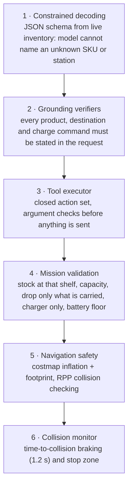

# Safety case and hazard analysis

Scope: the simulated warehouse AMR, with emphasis on the risks that the AI/agentic layer introduces. The question
this document answers is: **what stops a language model from making the robot do something harmful or wrong?**

> This is an engineering safety analysis for a simulation, not a certification. A physical deployment would need a
> safety-rated scanner and controller and conformity with the standards for driverless industrial trucks
> (ISO 3691-4) and safety-related control systems (ISO 13849). Nav2's collision monitor used here is not safety-rated.

## 1. Defence in depth

No single layer is trusted. Layers 1–4 stop wrong *missions*; layers 5–6 stop wrong *motion* whatever was commanded.

## 2. Hazard log

Severity (S): 3 = could cause collision or damage, 2 = wrong work done, 1 = nuisance. Status after mitigation.

| ID | Hazard | Cause | S | Mitigations (layer) | Verification evidence | Residual |
|---|---|---|---|---|---|---|
| H1 | Robot executes a mission nobody asked for | LLM hallucinates products (seen live: "top it up" → delivery of 2 parts) | 2 | product grounding + one retry + refuse (2) | regression case in dev set; 0 unsafe actions on 32 benchmark requests | Low |
| H2 | Mission to a non-existent station or SKU | LLM output outside the warehouse model | 2 | schema enums (1); executor checks (3); manager validation (4) | unit tests `test_executor_rejects_*`, `test_model_output_outside_schema_is_sanitised` | Very low |
| H3 | Items delivered to the wrong place | LLM picks wrong destination (seen live: "to shipping" → packing) | 2 | stated-destination override, unstated destinations dropped (2) | regression case; `test_stated_destination_*` | Low |
| H4 | Robot starts charging or moving on a question | intent misclassification ("is the robot charging?") | 1 | charge needs charging words and must not be a question (2) | held-out v2 trap case passes; keyword baseline fails it | Low |
| H5 | Collision with racks | 2D LiDAR sees through racking at scan height (seen in first map) | 3 | floor-level pallet faces mapped; inflation 0.55 m; footprint 0.52 × 0.46 m (5) | map v4 shows solid rack faces; 4 live missions through all aisles completed with 0 aborts | Low (sim); real site needs kick plates or keep-out zones |
| H6 | Collision with unmapped obstacle | obstacle not in map | 3 | local costmap replanning (5); time-to-collision braking + stop zone (6) | box-in-path tests at 0.2 and 0.5 m/s: detoured, closest ≈ 0.38 m from bumper, 0 aborts | Low |
| H7 | Robot runs flat mid-mission | long missions on low battery | 2 | agent/charge-first rule below 25 % (2/code); manager refuses non-charging trips below 10 % (4) | benchmark low-battery cases; unit tests | Low |
| H8 | Over-capacity or invalid pick/drop | planner or LLM error | 1 | manager validation before moving (4) | `SimBackend` mirrors the rules; unit tests | Very low |
| H9 | Wrong position estimate | odometry error, two `map → odom` publishers | 3 | odometry calibrated (drift 3 cm/45 m); SLAM and AMCL never run together; AMCL initial pose (2) | drift measurements; launch separation | Medium: no automatic relocalisation |
| H10 | Mission aborts or robot "stuck" | planner timeouts under load; crawling near shelves | 1 | BT server timeout 200 ms; one retry per leg; TTC braking instead of fixed slowdown circle (3/6) | 0 aborts in final runs (2 in the rejected slowdown-circle design) | Low |
| H11 | Agent unavailable | cloud outage, no credits, model not loaded | 1 | on-device model by default; Claude only if a test call succeeds; rule-based fallback; model kept resident | auto-selection tested with no API credits | Low |
| H12 | Malicious or garbled text from the command channel | anything that can publish `/agent/command` | 2 | the model can only fill a closed intent schema; tools are a fixed allow-list; dashboard bound to 127.0.0.1 | design review | Low (sim); a real site needs authenticated commands |
| H13 | Commands sent to a stale simulator | Windows Webots instance survives a WSL launch stop | 2 | `stop_sim.sh` kills Windows Webots; runbook check on port 1234 | found and fixed during development | Low |

## 3. Evidence summary

| Claim | Evidence |
|---|---|
| The agent does not execute unrequested missions | 0 unsafe actions on dev (12), held-out v1 (10) and fresh held-out v2 (10); free-form LLM loop on the same model: 4 |
| Verification was not tuned to the test | held-out v2 committed (`6db88a1`) before the final fix |
| Safety rules are enforced below the model | 31 unit tests; manager validation independent of the agent |
| Navigation is safe at the operating speed | obstacle tests at 0.5 m/s; collision monitor active in every run |
| Regressions are caught | benchmark re-run after every agent change; CI on every push |

## 4. Known limitations

- Simulation only; the battery, picking and dwell times are models.
- No automatic relocalisation if AMCL diverges; no multi-robot traffic management.
- The verifiers are lexical: a request that names a product only by a synonym that shares no word with its SKU is
  refused (safe) rather than understood.
- The benchmark is small (32 requests); it shows failure modes, not a reliability figure.
